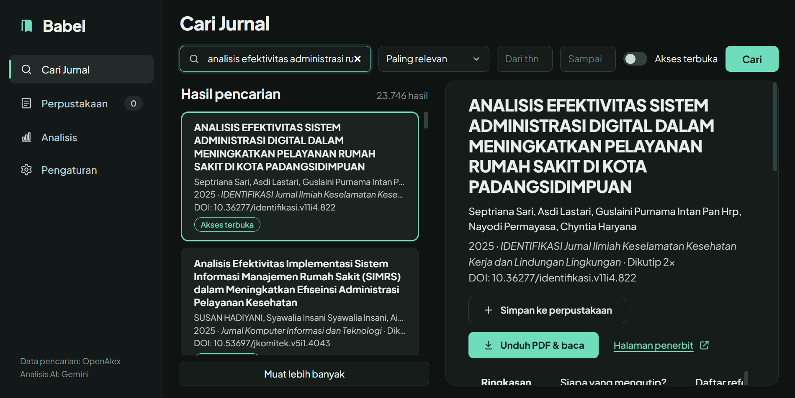
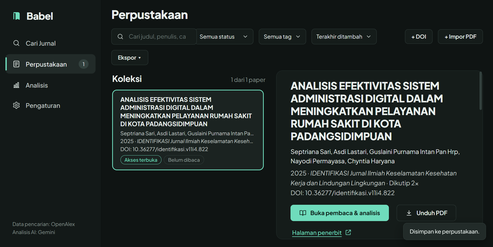
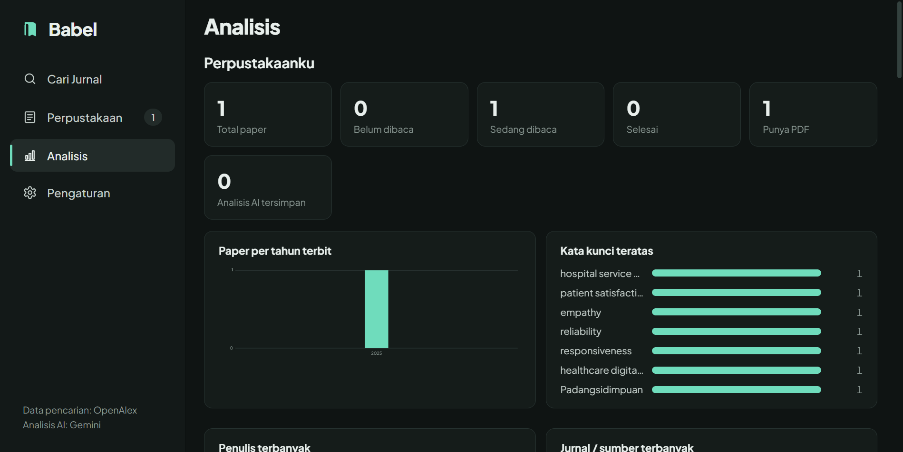

# Babel

**Aplikasi desktop untuk mencari, mengelola, membaca, dan menganalisis jurnal ilmiah, dengan bantuan AI.**

> *A desktop research assistant for finding, organizing, reading, and analyzing scientific papers. It searches 250M+ scholarly works via OpenAlex and uses Google Gemini or Claude to summarize and critique papers. The interface is in Indonesian.*



## Fitur

### 🔎 Cari jurnal
- Mencari di **lebih dari 250 juta karya ilmiah** lewat [OpenAlex](https://openalex.org), termasuk banyak jurnal Indonesia.
- Hasil bisa diurutkan berdasarkan relevansi, jumlah kutipan, atau tanggal terbit, lalu disaring menurut rentang tahun dan akses terbuka.
- Panel detail bertab: **Ringkasan**, **Siapa yang mengutip?**, **Daftar referensi**, dan **Paper terkait**. Kamu bisa menelusuri jaringan sitasi tanpa meninggalkan halaman.

### 📚 Perpustakaan pribadi
- Simpan paper, lalu beri status baca, rating, tag, dan catatan.
- Tambahkan paper lewat **DOI** atau **impor PDF lokal**.
- Ekspor daftar pustaka ke **BibTeX**, **RIS** (Mendeley/Zotero/EndNote), atau **APA**, dan salin sitasi APA dengan satu klik.



### 📖 Pembaca & analisis AI
- Pembaca PDF dengan panel catatan di sampingnya. PDF akses terbuka diunduh otomatis.
- Analisis AI yang membaca **teks lengkap PDF**:
  - ringkasan terstruktur (tujuan, metode, temuan, kontribusi, keterbatasan),
  - analisis metodologi,
  - telaah kritis ala reviewer jurnal,
  - bahan tinjauan pustaka,
  - tanya-jawab bebas tentang isi paper.
- Penyedia AI bisa dipilih: **Google Gemini** (gratis, dengan kuota) atau **Claude** (Anthropic, berbayar). Saat server Gemini sibuk, aplikasi otomatis mencoba ulang lalu beralih ke model cadangan.

### 📊 Analisis
- Statistik perpustakaan: paper per tahun, kata kunci, penulis, dan jurnal terbanyak.
- **Tren topik penelitian** di literatur dunia: publikasi per tahun, jurnal, penulis, dan institusi paling aktif, serta paper paling berpengaruh.



## Unduh

Versi portable untuk Windows 10/11 (64-bit) tersedia di halaman [**Releases**](../../releases). Ekstrak ZIP, lalu jalankan `Babel.exe`.

> Aplikasi belum ditandatangani secara digital. Jika muncul peringatan "Windows protected your PC", pilih **More info → Run anyway**.

## Teknologi

| Bagian | Teknologi |
|---|---|
| Aplikasi desktop | [Electron](https://www.electronjs.org/), HTML/CSS/JavaScript tanpa framework |
| Data jurnal | [OpenAlex API](https://docs.openalex.org/) |
| Analisis AI | Google Gemini API (streaming SSE), [Anthropic SDK](https://github.com/anthropics/anthropic-sdk-typescript) (Claude) |
| Penyimpanan | File JSON lokal, kunci API dienkripsi dengan `safeStorage` Electron |
| Font | [Plus Jakarta Sans](https://github.com/tokotype/PlusJakartaSans) (SIL OFL) |
| Paket | electron-builder |

### Arsitektur singkat

```
main.js      Proses utama: jendela, penyimpanan lokal, unduh PDF, panggilan AI (Gemini/Claude)
preload.js   Jembatan IPC yang aman (contextIsolation + sandbox)
src/         Antarmuka: index.html, styles.css, app.js
test/        Uji asap end-to-end dan uji coba-ulang Gemini dengan server tiruan
```

Beberapa keputusan desain:
- **Privasi:** semua data tersimpan lokal di komputer pengguna. Kunci API tidak pernah dikirim ke mana pun selain penyedia AI yang dipilih.
- **Keamanan:** renderer berjalan dengan `contextIsolation`, `sandbox`, dan Content Security Policy yang ketat. Tautan luar selalu dibuka di browser bawaan.
- **Ketahanan:** permintaan ke OpenAlex dan Gemini dicoba ulang otomatis saat terkena batas atau server sibuk, dengan pesan galat yang jelas dalam Bahasa Indonesia.

## Menjalankan dari kode

```bash
npm install
npm start
```

Untuk fitur AI, isi kunci API di menu **Pengaturan**:
- Gemini (gratis): [aistudio.google.com/apikey](https://aistudio.google.com/apikey)
- Claude (berbayar): [console.anthropic.com](https://console.anthropic.com/settings/keys)

### Pengujian

```bash
npx electron test/smoke.js ./smoke-output     # cari → simpan → baca → analisis tren
npx electron test/gemini-retry.js             # coba-ulang & model cadangan Gemini (server tiruan)
```

### Membuat installer Windows

```bash
npm run dist
```

Jalankan dari folder dengan path pendek, karena NSIS gagal jika path melebihi 260 karakter.

## Lisensi

[MIT](LICENSE). Font Plus Jakarta Sans memakai lisensi [SIL Open Font License](src/fonts/OFL.txt).
